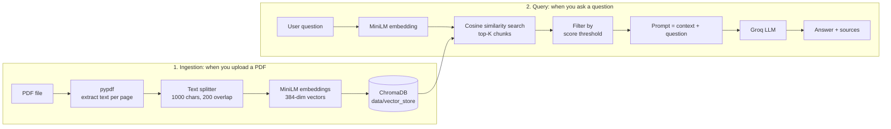

#  RAG Chat with Groq

Chat with your PDFs. Upload a document, ask a question in plain English, and get an answer that is **grounded in the document**, along with the exact pages it came from.

This project is a complete **Retrieval-Augmented Generation (RAG)** pipeline built from scratch: PDF ingestion, chunking, embeddings, a vector database, semantic retrieval, and an LLM that answers only from the retrieved context.

---

## Table of Contents

1. [What is RAG? (in simple words)](#what-is-rag-in-simple-words)
2. [Features](#features)
3. [Tech Stack](#tech-stack)
4. [Architecture](#architecture)
5. [Project Structure](#project-structure)
6. [How It Works (Implementation)](#how-it-works-implementation)
7. [Setup and Installation](#setup-and-installation)
8. [Usage](#usage)
9. [Configuration](#configuration)
10. [Troubleshooting](#troubleshooting)
11. [Limitations](#limitations)
12. [Future Improvements](#future-improvements)
13. [Learning Notes](#learning-notes)

---

## What is RAG? (in simple words)

A normal LLM only knows what it learned during training. It has never seen **your** PDF, so it cannot answer questions about it, and if you force it, it may make things up.

**RAG fixes this in two steps:**

1. **Retrieve**: find the small pieces of your document that are most relevant to the question.
2. **Generate**: give those pieces to the LLM as context and tell it to answer **only** from them.

> Think of it as an open-book exam. Instead of answering from memory, the LLM is handed the right pages of the book first.

## Live:
https://huggingface.co/spaces/vivek2477/pdf-rag-chatbot

## Features

- **PDF upload from the UI**: add new documents at any time, no restart needed
- **Automatic chunking and embedding**: handled for you on upload
- **Semantic search**: finds relevant text by meaning, not just keywords
- **Grounded answers**: the LLM is instructed to use only the retrieved context
- **Source citations**: every answer shows file name, page number and similarity score
- **Persistent storage**: embeddings are saved on disk, so nothing is re-computed after a restart
- **Duplicate-safe uploads**: uploading the same PDF twice does not create duplicates
- **Adjustable retrieval**: Top-K and score threshold sliders in the sidebar

---

## Tech Stack

| Layer | Tool | Why |
|---|---|---|
| UI | **Streamlit** | Fast way to build a data app in pure Python |
| PDF parsing | **pypdf** | Extracts text from PDFs, works fully in memory |
| Chunking | **LangChain Text Splitters** | `RecursiveCharacterTextSplitter` keeps paragraphs and sentences together |
| Embeddings | **sentence-transformers** (`all-MiniLM-L6-v2`) | Small, fast, 384-dimensional embeddings, runs locally |
| Vector DB | **ChromaDB** (persistent) | Simple local vector store with cosine similarity |
| LLM | **Groq API** (`openai/gpt-oss-20b`) | Very fast inference |
| Config | **python-dotenv** | Keeps the API key out of the code |
| Package manager | **uv** | Fast dependency management |

---

## Architecture

The system has two flows: **ingestion** (adding documents) and **query** (asking questions).



### Step-by-step

**Ingestion**
1. The PDF is read **in memory** (no temp files) and text is extracted page by page.
2. Each page is split into overlapping chunks of about 1000 characters.
3. Each chunk is converted into a 384-number vector (an *embedding*) that represents its meaning.
4. Chunks, vectors and metadata (file name, page) are stored in ChromaDB.

**Query**
1. Your question is converted into a vector using the same embedding model.
2. ChromaDB finds the chunks whose vectors are closest to the question vector.
3. Chunks below the score threshold are dropped as irrelevant.
4. The remaining chunks are pasted into a prompt together with your question.
5. The LLM answers using only that context, and the UI shows the sources.

---

## Project Structure

```
Rag/
├── app.py                      # Streamlit UI (upload, ask, show answer + sources)
├── src/
│   └── rag/
│       ├── __init__.py
│       └── rag_pipeline.py     # Core RAG class: ingest, retrieve, answer
├── notebook/
│   └── document.ipynb          # Step-by-step experiments (loaders, embeddings, retriever)
├── data/
│   ├── pdf_files/              # Sample PDFs
│   ├── text_files/             # Sample text files
│   └── vector_store/           # ChromaDB persistent storage (git-ignored)
├── .env                        # GROQ_API_KEY (git-ignored, never commit this)
├── pyproject.toml              # Project dependencies (uv)
├── requirements.txt
└── README.md
```

---

## How It Works (Implementation)

All the logic lives in one class: `RAG` in `src/rag/rag_pipeline.py`.

### 1. Initialization: `RAG.__init__`

```python
self.embedder = SentenceTransformer("all-MiniLM-L6-v2")
client = chromadb.PersistentClient(path="data/vector_store")
self.collection = client.get_or_create_collection(
    name="pdf_documents", metadata={"hnsw:space": "cosine"}
)
self.llm = Groq(api_key=os.getenv("GROQ_API_KEY"))
```

- Loads the embedding model once.
- Opens (or creates) a persistent ChromaDB collection that uses **cosine** distance.
- Creates the Groq client using the key from `.env`.

### 2. Ingestion: `add_pdf(file_bytes, filename)`

| Step | What happens |
|---|---|
| Read | `PdfReader(BytesIO(file_bytes))` reads the PDF directly from memory |
| Extract | Text is extracted per page and wrapped in LangChain `Document` objects with the page number |
| Split | `RecursiveCharacterTextSplitter(chunk_size=1000, chunk_overlap=200)` |
| Embed | `embedder.encode(texts)` gives one 384-dim vector per chunk |
| Store | `collection.upsert(...)` saves text, vectors and metadata |

**Why chunk?** An LLM prompt has limited space, and a whole PDF dilutes the meaning. Small chunks give precise matches.

**Why overlap?** With 200 characters of overlap, a sentence cut at a chunk boundary still appears fully in one of the chunks.

**Why `upsert` and file hash IDs?** Each chunk ID is `<md5 of file>_<chunk number>`. Uploading the same file again overwrites the same IDs instead of creating duplicates.

### 3. Retrieval: `retrieve(query, top_k, score_threshold)`

```python
q_emb = self.embedder.encode([query])[0].tolist()
res = self.collection.query(query_embeddings=[q_emb], n_results=min(top_k, total))
score = 1 - distance   # cosine distance -> similarity (0 to 1)
```

- The question is embedded with the **same model** as the documents (this is essential).
- ChromaDB returns the closest chunks.
- Similarity = `1 - cosine distance`. Chunks below `score_threshold` are dropped.

### 4. Generation: `ask(query, top_k, score_threshold)`

The retrieved chunks are joined into one context string and placed in a strict prompt:

```text
Answer ONLY using the context below. Do not use outside knowledge.
If the answer is not in the context, reply exactly: "I don't know based on the provided documents."
Write formulas in plain text, not LaTeX.

Context:
{context}

Question: {query}

Answer:
```

This is what stops the model from hallucinating. If nothing passes the threshold, the app returns "No relevant context found." without calling the LLM at all.

### 5. UI: `app.py`

- `@st.cache_resource` loads the `RAG` object only once, so the model is not reloaded on every click.
- **Sidebar**: Top-K slider, score threshold slider, PDF uploader, and a live chunk counter.
- **Main area**: question box, **Ask** button, answer, and an expander per source showing the file, page, score and the matching text.

---

## Setup and Installation

### Prerequisites
- Python 3.12
- [uv](https://docs.astral.sh/uv/) (or pip)
- A free Groq API key from [console.groq.com](https://console.groq.com) → **API Keys**

### Steps

```bash
# 1. Clone the repo
git clone https://github.com/<your-username>/rag-pdf-chat.git
cd rag-pdf-chat

# 2. Install dependencies
uv sync
# or: pip install -r requirements.txt
```

```bash
# 3. Add your API key (create a file named .env in the project root)
GROQ_API_KEY=your_key_here
```

> ⚠️ Never commit `.env` or paste your key anywhere public. If a key is ever exposed, delete it in the Groq console and create a new one.

```bash
# 4. Run the app (always from the project root)
uv run streamlit run app.py
```

Open **http://localhost:8501** in your browser.

---

## Usage

1. **Upload a PDF** in the sidebar and click **Add to knowledge base**.
2. Wait for the success message, for example `Added 52 chunks from paper.pdf`.
3. **Ask a question** in the main box and click **Ask**.
4. Read the **Answer**, then open the **Sources** expanders to verify it.

**Good questions** are specific and answerable from the document:
- "What is self-attention?"
- "What is BPE tokenization?"
- "What is the vocabulary size of GPT-2?"

**Tuning retrieval**
- Getting "No relevant context found"? Lower the **score threshold** (for example to 0.2) or rephrase the question.
- Answers feel incomplete? Increase **Top K**.
- Answers feel noisy or off-topic? Raise the **score threshold**.

---

## Configuration

| Setting | Where | Default |
|---|---|---|
| Embedding model | `RAG.__init__` | `all-MiniLM-L6-v2` |
| LLM model | `RAG.__init__` (`llm_model`) | `openai/gpt-oss-20b` |
| Vector store path | `RAG.__init__` (`persist_dir`) | `data/vector_store` |
| Collection name | `RAG.__init__` (`collection_name`) | `pdf_documents` |
| Chunk size / overlap | `add_pdf` | `1000` / `200` |
| Top-K / threshold | UI sliders | `3` / `0.3` |
| LLM temperature / max tokens | `ask` | `0.1` / `1024` |

> Groq's list of available models changes over time. To see what your key can use:
> ```python
> from groq import Groq
> print([m.id for m in Groq().models.list().data])
> ```

---

## Troubleshooting

| Problem | Cause and fix |
|---|---|
| `GROQ_API_KEY not found in .env` | Create `.env` in the project root with `GROQ_API_KEY=...`, no quotes, no spaces |
| `404 model_not_found` | The model was removed or is not available to your key. List models (see above) and change `llm_model` |
| `No relevant context found` | Threshold too high, the question is not about the uploaded documents, or the PDF has no text |
| `No text found` on upload | The PDF is scanned or image-only. It needs OCR first |
| `'RAG' object has no attribute ...` | Streamlit cached the old class. Stop the server (`Ctrl+C`) and start it again |
| `No space left on device` | Your disk is full. Free space (the app itself writes no temp files) |
| `ImportError: cannot import name 'RAG'` | Check the import path: `from src.rag.rag_pipeline import RAG` |
| `No module named 'torchvision'` in terminal | Harmless Streamlit watcher warning. Run with `--server.fileWatcherType none` to hide it |
| First run is very slow | The embedding model is downloading and `torch` is loading. Later runs are fast |
| No results after changing the collection | Rebuild the retriever or restart so it does not hold a stale collection reference |

---

## Limitations

- **Scanned PDFs** are not supported (no OCR).
- **Tables, formulas and figures** may be extracted as plain, messy text.
- **No conversation memory**: each question is answered independently.
- **Search covers all uploaded PDFs** together; there is no per-document filter yet.
- Answer quality depends on chunk quality. Chunk size and overlap may need tuning per document type.

---

## Future Improvements

- Per-document filter (search inside one selected PDF)
- Chat history and follow-up questions
- Streaming answers token by token
- Re-ranking retrieved chunks with a cross-encoder
- OCR support for scanned PDFs
- Hybrid search (keyword + semantic)
- Evaluation of retrieval quality (hit rate, MRR)
- Deployment on Streamlit Community Cloud or Hugging Face Spaces

---

## Learning Notes

The `notebook/document.ipynb` file contains the step-by-step build-up that led to this app:

1. Loading text and PDF files with LangChain loaders (`TextLoader`, `DirectoryLoader`, `PyPDFLoader`)
2. Splitting documents into chunks
3. Generating embeddings with `SentenceTransformer`
4. Storing vectors in ChromaDB
5. Building a retriever with similarity scoring
6. Connecting retrieved context to an LLM
7. Moving the notebook code into a clean module (`rag_pipeline.py`) and a Streamlit app

Key lessons from building it:
- Chroma's default distance is **L2**; using **cosine** makes `similarity = 1 - distance` meaningful.
- A retriever that holds a reference to a deleted collection silently returns nothing. Rebuild it.
- Using the same embedding model for documents and queries is non-negotiable.
- A strict prompt ("answer only from the context") is what keeps the LLM honest.

---

## Author

**Vivek**: B.Tech CSE (Machine Learning), Gautam Buddha University

Built as part of learning LLM and RAG engineering from scratch.
